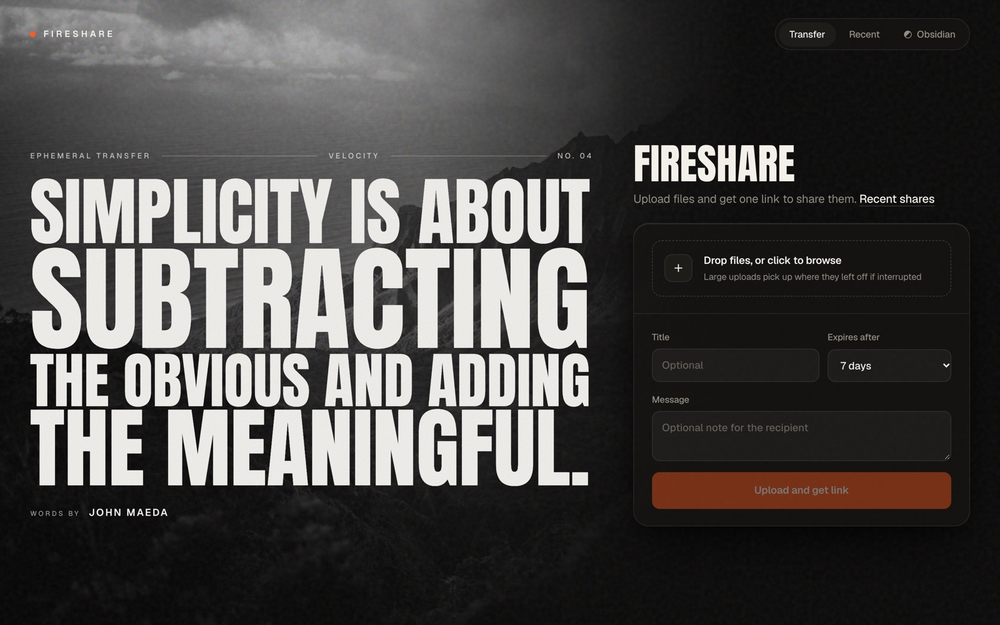
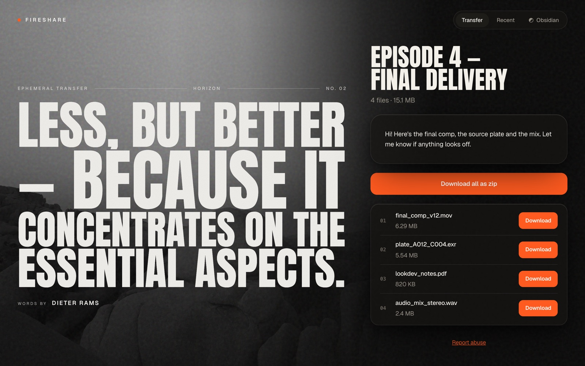

# FireShare

[](https://github.com/NotYourBurger/FireShare/actions/workflows/ci.yml)
[](LICENSE)

Self-hosted temporary file sharing: upload files, get a link, send it. People you send the link to don't need an account. Every share expires, and its files are then deleted automatically. FireShare is built for large files (up to 50 GB per share by default), and both uploads and downloads resume after interruptions.

<p align="center">
  
  
</p>
<p align="center"><sub>Left: the upload page. Right: what recipients see.</sub></p>

- **One link per share:** a share holds one or more files. Recipients can download each file separately, or download all of them as one zip that also resumes.
- **Expiring by design:** uploaders choose an expiry from presets you set. A share's link stops working the moment it expires or is deleted.
- **Management link:** uploaders get a second, secret link. It shows the share's status and lets them delete it early. Their browser also keeps a list of recent shares, so no account is needed.
- **Locked down by default:** uploading requires a password, and you can also restrict it to certain IP networks. The storage server is never exposed. The app checks the integrity of every file and detects if a stored file has been changed. It also has per-IP quotas and rate limits.
- **Fast on the LAN:** an optional *direct* mode lets browsers on your network upload to and download from storage directly, at disk speed. Everyone on the internet still goes through the app.
- **Small footprint:** the stack is Next.js, PostgreSQL and [Garage](https://garagehq.deuxfleurs.fr) (S3-compatible, with zstd compression). Images are built for amd64 and arm64, and it runs comfortably on a 2 GB NAS.

See [`vision.md`](vision.md) for the design and roadmap.

---

## Quick start

You need Docker with Compose v2, on any x86_64 or ARM64 machine.

```sh
git clone https://github.com/NotYourBurger/FireShare.git
cd FireShare
cp .env.example .env
```

Open `.env` and replace every `change-me…` value:

| Variable | Set it to |
|---|---|
| `POSTGRES_PASSWORD` | `openssl rand -hex 24` |
| `GARAGE_RPC_SECRET` | `openssl rand -hex 32` (it **must** be exactly 64 hex characters) |
| `GARAGE_ADMIN_TOKEN` | `openssl rand -hex 24` |
| `UPLOAD_PASSWORD` | a password you'll give to the people who upload |

Then start it:

```sh
docker compose up -d
```

Open <http://localhost:3000>, enter the upload password, pick some files and upload them. You get a **share link** to send to people, and a **management link** to keep for yourself.

On first start, Compose pulls the published images and creates the database, a private storage bucket and the app's own storage key. If it can't pull the images, it builds them from source.

If something doesn't come up, run `docker compose logs app worker storage storage-init`. A bad setting stops the app at startup with a list of every variable to fix; see [troubleshooting](docs/troubleshooting.md).

> [!IMPORTANT]
> ### Uploading needs HTTPS (or localhost)
> Browsers only allow a page to upload through FireShare when it's opened over **`https://`** or on **`localhost`**. This is because FireShare checks every chunk with the browser's Web Crypto API, which browsers turn off on insecure pages.
>
> So if you open `http://192.168.1.10:3000` from another computer on your LAN, the page loads and downloads work, but **uploading is refused** with "Uploading needs a secure connection".
>
> Pick one:
> 1. **Put it behind an HTTPS reverse proxy.** This is the recommended option, even on a LAN. See [deployment](docs/deployment.md) for Caddy, nginx, Traefik, Synology and Cloudflare Tunnel.
> 2. **Use localhost only:** open it on the machine running Docker, or through an SSH tunnel (`ssh -L 3000:localhost:3000 server`).
> 3. **Use direct mode** on a trusted LAN. Browsers then upload straight to storage, which needs no Web Crypto, so the page itself can be plain HTTP. See [direct mode over plain HTTP](docs/deployment.md#direct-mode-over-plain-http-trusted-lan-only). This is less safe: links and presigned storage URLs travel unencrypted.

---

## Configuration

All settings live in `.env`. [`.env.example`](.env.example) explains each one, and **[docs/configuration.md](docs/configuration.md)** lists every variable with its default, its allowed values and which container reads it. After changing `.env`, apply it with `docker compose up -d`.

| You want to… | Set |
|---|---|
| Choose who can upload | `UPLOAD_PASSWORD`, or `ALLOW_PUBLIC_UPLOAD=true` + `ABUSE_CONTACT` |
| Restrict uploads to your office or VPN | `UPLOAD_ALLOWED_IPS=192.168.1.0/24,10.8.0.0/16` |
| Change the expiry choices | `EXPIRY_OPTIONS=12h,1d,7d`, `EXPIRY_DEFAULT=1d` |
| Cap the size and number of files | `MAX_SHARE_SIZE`, `MAX_FILES_PER_SHARE`, `MAX_TOTAL_STORAGE` |
| Stop one person filling the disk | `UPLOAD_QUOTA_PER_IP`, `MAX_ACTIVE_SHARES_PER_IP`, `RATE_LIMIT_UPLOAD` |
| Run behind a reverse proxy | `TRUSTED_PROXIES` (otherwise every client looks like the proxy) |
| Get full LAN speed | `TRANSFER_MODE=auto` + `STORAGE_DIRECT_ENDPOINT` + `DIRECT_NETWORKS` + `APP_ORIGIN` |
| Make no outbound requests | `QUOTES=offline` |
| Use a different port | `APP_PORT=8080` |

FireShare refuses to start with an unsafe or contradictory setup, for example no upload password without explicitly allowing public uploads, or direct mode without an HTTPS storage endpoint. It names each setting to fix. It also logs a `Warning:` at startup for settings that are valid but risky, like public uploads with no quota.

## Hosting it

FireShare is one Compose stack, so it runs anywhere Docker does: a VPS, a home server, a Synology or other NAS, Portainer, Unraid, and so on. **[docs/deployment.md](docs/deployment.md)** covers:

- HTTPS reverse proxies: Caddy, nginx, Traefik, Synology DSM and Cloudflare Tunnel, with the headers and body-size limits each needs
- LAN-only installs
- Direct and auto transfer modes, including how to expose storage to your LAN only
- Using your own PostgreSQL and S3 (AWS S3, MinIO, Cloudflare R2, …) instead of the bundled ones
- Portainer and other UIs that deploy a Compose stack

## Updating

```sh
git pull
docker compose pull
docker compose up -d
```

Database migrations run automatically when the app starts. `FIRESHARE_VERSION` in `.env` chooses the image: `latest` (the newest release, which is the default), a release such as `1.2` or `1.2.3`, or `main` (the newest build of the main branch). To build the images from your checkout instead, run `docker compose up -d --build`.

See [CHANGELOG.md](CHANGELOG.md) for what changed, including steps for upgrading from older versions.

## Backups

All state lives in two Docker volumes: `db-data` (PostgreSQL) and `storage-data` (the files). Back them up together, with the stack stopped. See [docs/deployment.md#backups](docs/deployment.md#backups). Shares are temporary, so many people back up only the database, or nothing at all.

## Security

- The storage API is never published. It sits on an internal Docker network with no route in or out. Direct mode adds a LAN-only HTTPS endpoint that you configure.
- The bucket is private. The app's storage key can access only that bucket, and the storage admin token is used only by the one-off `storage-init` container.
- Link tokens are 128-bit random values, and only their hashes are stored. Files are always served as downloads, with `nosniff`. Every chunk is checksummed, and the app refuses to serve a file whose stored copy has been changed.
- Every container runs as a non-root user with `no-new-privileges`, no Linux capabilities and a memory limit.

**[docs/security.md](docs/security.md)** explains every security layer, the setting that controls it, and the limits of each. To report a vulnerability, see [SECURITY.md](SECURITY.md). Please don't open a public issue.

### Privacy

FireShare runs no analytics and no tracking. Pages load fonts and images only from FireShare itself. The only outbound request the app makes is to [zenquotes.io](https://zenquotes.io) for the quote shown on each page, and `QUOTES=offline` turns that off too.

## Development

```sh
pnpm install
pnpm dev        # needs DATABASE_URL and S3_* in .env, see CONTRIBUTING.md
pnpm test
pnpm typecheck
```

See [CONTRIBUTING.md](CONTRIBUTING.md) for running a local database and storage, how the code is laid out, and how to send a pull request. CI builds amd64 and arm64 images and publishes them to `ghcr.io/notyourburger/fireshare` and `ghcr.io/notyourburger/fireshare-worker`.

## License

[MIT](LICENSE). The bundled storage, Garage, is AGPL-3.0 and runs unmodified in its own container. The backdrop photos are from Pexels; see [credits](public/backdrops/CREDITS.md).
